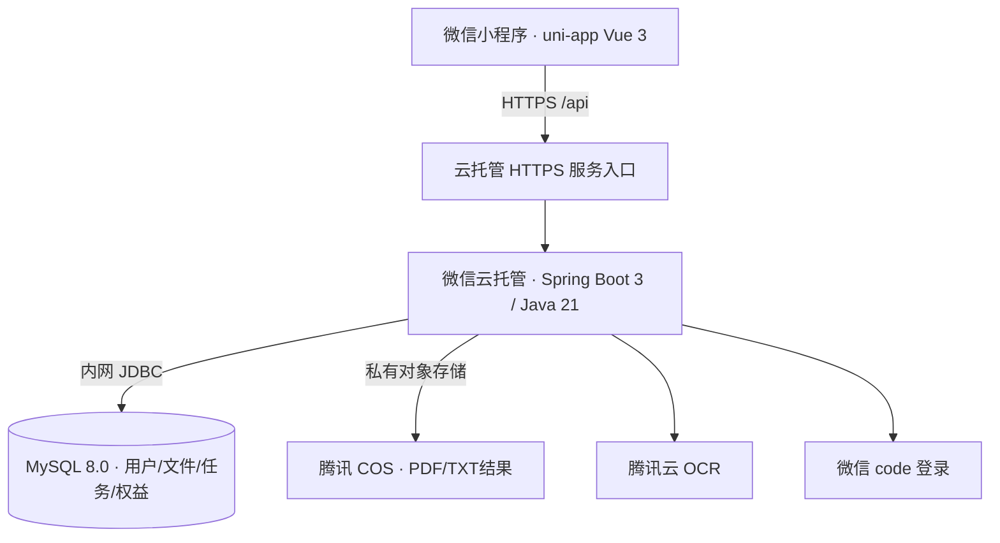

# 登科喵资料助手：微信云托管 + MySQL 8.0

部署目标为微信小程序前端、微信云托管中的Spring Boot服务、MySQL 8.0、腾讯COS私有文件桶和腾讯云OCR。小程序AppID已设置为 `wx32e637fe68951abc`。当前代码已经具备容器与环境变量配置；尚未创建云资源或向云端发布。

资料平台升级增加分类、资料、收藏、下载记录和反馈表。已有云环境先执行 `database/migrations/002_resource_library.sql`，生产关闭 `SEED_DEMO`。正式内容需由维护方导入，当前开发环境提供的是原创示例文件。

## 一期部署架构

| 组件 | 部署位置 | 用途 |
| --- | --- | --- |
| 前端 | 微信开发者工具上传的小程序版本 | 文件选择、工具页面、结果与历史 |
| 后端 | 微信云托管容器服务，建议服务名`dengke-doc-api` | 登录、PDF处理、OCR调用、文件归属与次数校验 |
| 数据库 | MySQL 8.0，后端可访问的内网地址 | 持久化用户、任务、OCR记录、文件元信息及权益 |
| 文件 | COS私有桶 | PDF/TXT结果，不使用容器临时磁盘作为生产存储 |
| OCR | 腾讯云通用文字识别 | 仅后端调用，密钥不传给小程序 |

数据库明确选择MySQL 8.0。如果控制台内置数据库不提供8.0，可使用腾讯云MySQL 8.0实例，并确认网络互通。云托管后端与数据库优先处于同地域、同VPC，使用内网地址连接，不开放数据库公网访问。[腾讯云内网访问MySQL说明](https://cloud.tencent.com/document/product/1243/49231)

当前前端已经使用`uni.request`、`uni.downloadFile`和后端Bearer会话，所以一期采用云托管HTTPS入口，填入`VITE_API_URL`。在微信后台配置request/downloadFile合法域名。`wx.cloud.callContainer`可作为后续接入方式，但当前代码未实现这条调用链，不能只设置云环境ID就替代现有API客户端。

## 容器配置

- Git仓库部署选择分支 `main`，构建目录为仓库根目录（`.`），Dockerfile路径为 `Dockerfile`。根目录入口只打包后端，排除本地环境文件、前端和设计素材。
- 如使用子目录构建，上下文可设为 `backend/`，使用该目录内的 `Dockerfile`；不要混用根目录Dockerfile与子目录上下文。
- 容器HTTP端口：8080；监听端口必须与云托管控制台配置一致。应用支持`PORT`环境变量。
- 健康探测路径：`GET /api/health`，仅表示HTTP服务已运行；数据库另做连接验证。
- 起步资源建议：1核/2GB，至少保留1个实例供一期验收；这是运行建议，不是平台默认配置或费用承诺。
- JVM当前最大堆768MB；每实例同时最多处理2项任务。实例扩容后，共享MySQL和COS。

云托管中仅部署后端镜像；`compose.yml`用于本机联调，不把MySQL本地容器作为线上持久化服务。

## 生产环境变量

当前版本已移除 Redis，登录会话存入 MySQL 的 `login_session` 表，7 天过期，数据库仅保存 token 摘要。已导入旧版初始化脚本的环境，升级前执行 `database/migrations/003_mysql_sessions.sql`；新库直接导入最新版 `database/init.sql`。旧 Redis 会话失效，用户需重新登录。

暂未配置 COS 时可设 `STORAGE=local`，`COS_BUCKET` 默认空字符串，不影响启动。本地文件仅适用于联调，容器更新或切换实例可能丢失文件。配置私有桶和凭据后设为 `STORAGE=cos`，本地已有文件不会自动迁入 COS。

模板位于 `deploy/wechat-cloud.env.example`。密码与云密钥只在本地安全文件或云托管环境配置中填写，不提交仓库、不发到聊天、不放前端。

| 变量 | 配置 |
| --- | --- |
| `PORT` | `8080` |
| `DEV_LOGIN` | `false` |
| `DB_URL` | MySQL 8内网JDBC地址、数据库`dengke` |
| `DB_USER` / `DB_PASSWORD` | 独立应用数据库账号 |
| `WX_APP_ID` | `wx32e637fe68951abc` |
| `WX_SECRET` | 微信AppSecret |
| `STORAGE` | `cos` |
| `COS_BUCKET` / `CLOUD_REGION` | 私有桶名称与地域 |
| `CLOUD_SECRET_ID` / `CLOUD_SECRET_KEY` | 服务端云凭据，限制到所需OCR/COS资源 |
| `FREE_DAILY_LIMIT` | 默认`5` |
| `SQL_INIT_MODE` | 首次导入SQL后设置`never` |

## 发布顺序

1. 准备MySQL 8.0和COS私有桶，并确认云托管到数据库的网络可达。
2. 创建`dengke`数据库（utf8mb4），执行`database/init.sql`，设置应用账号权限。
3. 构建并上传后端镜像；配置上表中的环境变量和容器端口8080。
4. 验证`/api/health`、微信登录、图片转PDF、文件历史、PDF下载和OCR。未配置云密钥时OCR会明确报错。
5. 配置前端`VITE_API_URL`为云托管HTTPS入口，构建微信小程序；配置合法域名并做真机验收。
6. 确认`DEV_LOGIN=false`；高级工具包仍显示“即将开放”，支付尚未接入。

一期上传仍经过HTTP接口，当前代码上限为单文件20MB、总请求100MB；实际可用上限还受云托管入口、请求超时和手机内存影响，必须在部署后验证。生产大文件建议下一阶段增加COS签名直传和异步任务，不能把当前同步接口当作已完成的大文件生产方案。

## 下一阶段

大文件采用“小程序签名上传COS → 创建任务 → 后端异步处理 → 查询任务 → 下载结果”。MySQL保存任务状态，任务队列协调处理；新增微信支付回调验签、订单幂等、权益授予、退款及文件过期清理。以上是后续工作，尚未在本版实现。

官方说明：[微信云托管说明](https://cloud.tencent.com/document/product/876/113602)、[云托管常见问题与端口配置](https://cloud.tencent.com/document/faq/1243/59521)。
