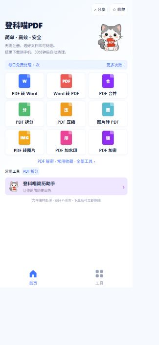

# 登科喵PDF 开发与部署

当前产品为无需注册的 PDF 工具小程序，底部标签为首页、AI、工具和文件列表。免费工具共用上传、异步处理、结果下载流程。收藏的是工具入口，保存在设备本地；工具页右上角分享的是小程序入口，文件列表转发的是本地结果文件。简历助手只有介绍入口，尚未配置目标小程序 AppID。

## 免费工具批量处理与文件列表（2026-10-20）

独立文件工具支持每批最多20个文件、单个20MB、总计60MB，前端逐个提交现有任务并轮询，成功与失败分开显示。一份失败不会丢弃其他成功结果。PDF合并仍为2至10个合成一份；比较仍为两份比较；图片合成保留组合模式，“每张一个PDF”模式生成独立任务。签名和图片水印复用本批选择的同一张图片；加解密等参数应用于本批文件。

去水印按每份文件分别检测、选择候选和预览，只有各文件取得各自的预览凭证后才能提交，禁止跨文件复用凭证。凭证有效期仍为10分钟；选择文件发生变化后需重新确认预览。

结果页只保留下载入口和批次结果，不提供打开文档或直接转发按钮。小程序下载成功后写入现有导出记录并切换到“文件列表”，默认选中本次下载文件。下载失败的任务暂存在本地待下载列表，保留原服务端过期时间，可在文件列表重试。H5保留浏览器下载方式。

文件列表支持勾选、取消、全选（每次最多20个）。单选使用原始文件转发，多选在手机本地生成ZIP（不重新上传文件、不压缩改写内容，总大小最多100MB），保留中文文件名并为重名文件加序号。首次点击多选转发准备ZIP，下一次点击直接唤起微信选择好友；不在异步下载或打包后自动打开原生分享窗口。

单个结果仍按服务端30分钟有效期清理，重复下载不延长保留期；合集以其中最早的文件过期时间为准。尚未交给微信的合集在页面离开或选择变化时清理；已交给微信的合集保留到原定过期时间，避免页面隐藏、分享回调或退出后删除文件导致微信发送/重试中断。回调提示为“已交给微信发送”，不作为聊天文件已送达的证明。崩溃残留在后续过期清理中删除。只删除应用生成的文件，不删除源文档。

自动检查涵盖批量任务隔离、部分失败、每文件水印凭证、文件列表导航、多选过期校验、重试记录、ZIP结构及点击转发时序。小程序上传、批量转换、ZIP转发保存仍需微信真机验证，构建通过不能代替这些验收。

## 已实现工具

| 工具 | 行为与限制 |
| --- | --- |
| PDF 转 Word | PDFBox 提取文字，生成 DOCX；扫描件不支持，复杂布局不保证还原 |
| Word 转 PDF | LibreOffice headless 真实转换 DOC/DOCX，90 秒超时，字体可能导致排版差异 |
| 合并 | 2 至 10 个 PDF，按选择顺序合并，最多 200 页 |
| 拆分 | 按每页或 `1-3,5,8-10` 范围拆分，生成 ZIP |
| 压缩 | 轻量、标准、强力三种图片压缩质量；不保证所有 PDF 都能缩小 |
| 图片转 PDF | JPG/PNG 按顺序生成 A4 PDF，可合成一个或每张单独生成 ZIP |
| PDF 转图片 | 每页 144 DPI JPG/PNG，生成 ZIP，最多 50 页 |
| 水印 | 文字或图片水印，半透明居中；中文字体随镜像安装 |
| 加密 | 6 至 64 位密码，AES-256 |
| 解密 | 需要有效密码和修改权限，不破解未知密码 |

每个输入文件不超过 20MB，总输入不超过 60MB，输出不超过 100MB。进度为真实阶段进度：上传完成后 10%，处理中 35%，成功 100%；不模拟逐百分比转换速度。

## 次数和商业化

基础 PDF 工具永久免费、不限次数。`PDF_BILLING_ENABLED` 默认 `false`；设为 `true` 仅开放 AI 月卡和加油包购买，不限制基础 PDF 工具。每天赠送 5,000 免费额度，无需购买也可调用 DeepSeek AI 接口。每个账号每日最多请求 100 次；AI 月卡每个周期含 2,000,000 Token 等价值额度，9.90 元加油包另增 1,000,000 额度，长期有效且会员到期后可用，优先扣当日免费额度，再扣月额度和加油包；单次文字 PDF 最多 30 页/15,000 个字符，扫描件 OCR 最多 5 页，输出最多 1,500 tokens。直接提交处理，模型返回实际 token 用量后结算，最多扣至余额为 0。详见 [月卡和成本规则](MONTHLY_MEMBERSHIP.md)。

AI 预估步骤会将 PDF 上传到本服务端做文字提取，预估内容不发给 DeepSeek；用户确认分析后才将 PDF 文本或选定页面图像传给 DeepSeek。

AI 月卡建议价为 **9.90 元一个月**，会员有效期到下个月同一天同一时间，无对应日期时按月末。已发送给模型的请求会计入 token 额度；微信支付 API v3 代码已接入，需配置商户环境变量并在真机验收后才能确认真实支付上线。

激励视频方向为完整看完获得一次额度。当前没有广告位，入口和服务端奖励接口都关闭，不接受客户端声明观看完成来直接发次数。后续需核查该账号流量主资格、开通广告单元并落实防重复奖励验证。分享、收藏不会兑换额度，不诱导分享。

官方参考：[小程序支付接入准备](https://pay.wechatpay.cn/doc/v3/merchant/4015459512)、[微信支付小程序下单](https://pay.wechatpay.cn/doc/v3/merchant/4012791897)、[腾讯广告激励视频说明](https://intl.cloud.tencent.com/zh/document/product/1219/68596?lang=zh)。支付上线状态以商户配置和真机验收为准。

## 临时文件和运行方式

上传文件只驻留处理内存；Word 转换的临时输入与转换目录在任务结束时清理。密码只传给本次任务，不写入数据库或日志。输出在 `PDF_TEMP_DIR` 暂存 30 分钟，每分钟清理一次，过期接口立即拒绝下载。服务器定时自动清理结果，页面无需用户手动清理。数据库保留的只是设备凭证摘要、额度和短期任务信息，不保存原文件名或文件正文。

当前临时结果是实例本地文件，**云托管应保持一个活动实例，关闭自动扩成多个实例**。重新部署可能使尚未下载的结果丢失。多实例需要共享临时对象存储和可靠任务队列，这是后续工作。旧版 `COS_BUCKET` 不用于新版临时结果，新版不要求 Redis、微信 AppSecret 或 COS 凭据，相关模块及环境变量已清理。

容器最多同时处理两项任务，等待队列四项。服务中断的未完成任务在到期清理时返还预占次数；不要将应用就绪探测等同于数据库和转换组件验收。

## 数据库升级

已有 `dengke` 库先执行 `database/migrations/004_pdf_tools.sql`，增加以下表：`pdf_visitor`、`pdf_daily_quota`、`pdf_tool_job`、`pdf_credit_balance`、`pdf_purchase`。随后部署最新纯PDF工具后端，备份数据库，再执行 `database/migrations/005_remove_legacy_tables.sql`，删除14张旧模块表及其数据。此脚本不删除任何 `pdf_*` 表。旧资料列表与微信登录接口已从后端移除。

新库可只执行 `database/pdf-tools-init.sql`。`database/init.sql`、`database/pdf-tools-init.sql` 和后端 schema.sql 均只包含5张新版PDF工具表；生产导入后设置 `SQL_INIT_MODE=never`，不会重新创建旧表。

生产配置模板见 `deploy/pdf-tools.env.json.example`。数据库地址用实际内网地址，容器端口 8080，健康探测 `/api/health`，平台探测 `/__tcb_probe__` 均无需登录。

Dockerfile 已安装 LibreOffice Writer 和 WenQuanYi 中文字体，初次构建镜像耗时和镜像大小会增加。云托管需为 JVM 与 Office 子进程一起留内存；先用 2GB 实例验收，不要按 768MB Java 堆大小推算整个容器内存。

## 接口

| 请求 | 用途 |
| --- | --- |
| `GET /api/pdf/config` | 基础工具永久免费状态、AI 月卡套餐和保留时间 |
| `POST /api/pdf/visitor` | 创建匿名设备凭证 |
| `GET /api/pdf/quota` | 查询今日剩余次数 |
| `POST /api/pdf/jobs` | multipart 上传 `files`、`tool` 和各工具选项 |
| `GET /api/pdf/jobs/{id}` | 本设备任务状态 |
| `GET /api/pdf/jobs/{id}/file` | 本设备结果下载 |
| `DELETE /api/pdf/jobs/{id}` | 主动删除完成或失败任务结果 |
| `POST /api/pdf/login` | 用 `wx.login` code 校验并绑定当前设备身份的微信 OpenID |
| `POST /api/pdf/purchase` | 创建 AI 月卡订单并返回小程序调起支付参数 |
| `GET /api/pdf/purchase/{id}` | 查询当前设备拥有的订单支付状态 |
| `POST /api/pdf/pay/notify` | 验证微信支付通知并幂等开通月卡 |
| `POST /api/pdf/ad-reward` | 当前 503，广告未开通 |

除配置、创建凭证及关闭的商业化入口外，接口要求 `Authorization: Bearer <匿名凭证>`。任务 ID 不足以下载文件，服务端校验所有者和到期时间。生产接入地址由 `frontend/.env.production` 配置；真实微信分享、保存 ZIP、合法域名仍需微信真机验收。

## 品牌素材与预览

本轮验证：14 项后端测试通过，H5 与微信小程序构建通过，小程序包约 0.18MB。真实容器验证 Word 转 PDF 和中文水印均输出有效 PDF；浏览器验证匿名上传、拆分、下载 ZIP、收藏工具以及每日额度扣减。旧资料平台、登录、OCR/COS代码及其测试已移除，当前测试覆盖PDF工具、免费额度、文件归属和健康探测。微信真机分享、ZIP 分享保存及正式域名仍需上线配置后验收。

灰白猫由 imagegen 内置工具生成透明 PNG，原图 `branding/pdf-cat-original.png` 保留，页面使用优化尺寸的 `frontend/src/static/brand/pdf-cat.png`。完整生成提示词在 `branding/pdf-cat-prompt.txt`。

## AI 精简与报告导出（2026-10-16）

AI仅接受 summary、translate 两种模式。总结按文档概览、重点内容、主要结论、待办事项生成报告。POST /api/pdf/ai/export 接收 content 与 format（docx/pdf），需设备凭证；使用已生成内容导出，不调用模型、不扣AI额度。PDF复用LibreOffice Writer转换，仍需部署该组件与中文字体。

估算和执行翻译均接收 targetLanguage：zh-CN、zh-TW、en、ja、ko、fr、de、es、pt、ru、ar、it。选项分别为简体中文、繁体中文、英语、日语、韩语、法语、德语、西班牙语、葡萄牙语、俄语、阿拉伯语、意大利语。源语言自动识别，输出文字译文，不承诺保留原PDF版式。达到模型输出上限会明确提示未完整生成，建议拆分后处理。

基础去水印：POST /api/pdf/watermarks/inspect 检测候选；/watermarks/preview 根据 candidateIds 生成前后预览与短期凭证。常规 jobs 接口使用 remove-watermark、candidateIds、previewProof 生成新PDF，原文件不改动。候选可能是正文或装饰，需用户确认预览。当前凭证限单实例、10分钟有效。

### 翻译 PDF 导出优先级

优先保证完整译文可导出。先尝试保留原页版式；版面溢出等原因导致原版式不可用时，自动生成可换行、可新增页面的顺排译文 PDF，并附原页作为图片与图形参考。此过程复用已生成的译文，不再次调用 AI。保留期内旧版只存有译文的完成任务，也支持按需生成并缓存顺排 PDF，导出不扣额度、不增加每日次数、不延长 30 分钟有效期。
