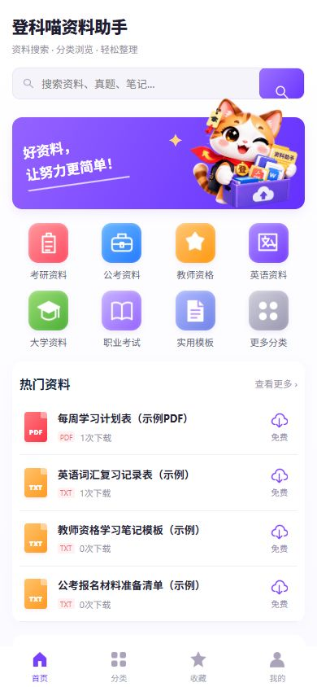
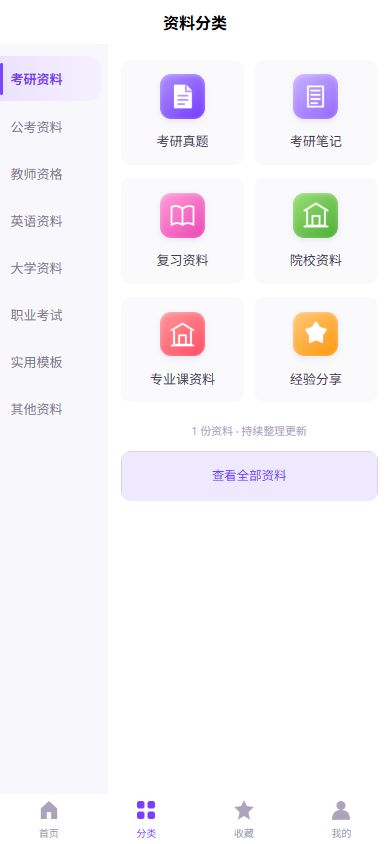
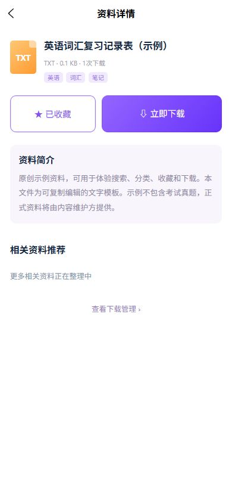
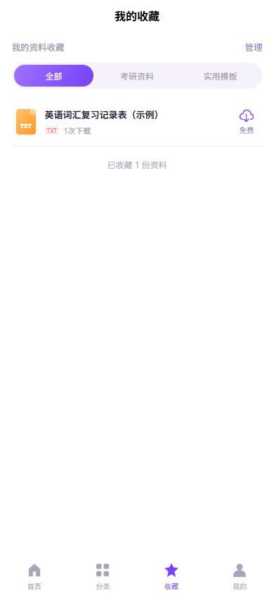
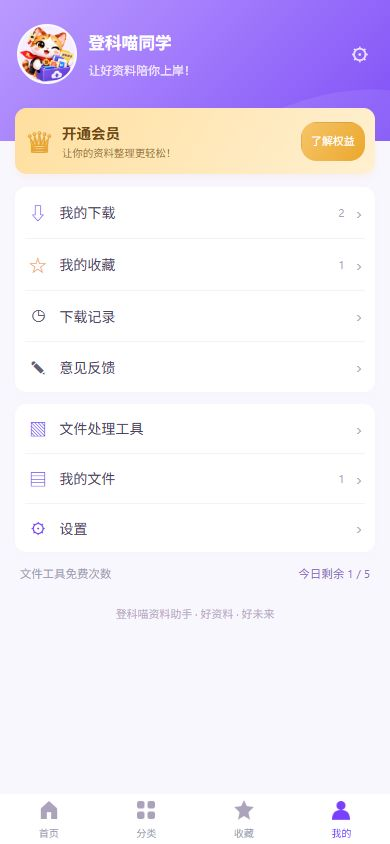

# 登科喵资料助手 · 新版UI预览

以用户最新资料助手设计图为准，改为紫白主题。新增资料搜索、分类、收藏和下载管理，保留PDF/OCR文件工具。以下为390×844的实际H5截图，展示的是明确标注的原创示例文件。

后端16项测试通过；H5与微信小程序构建通过；小程序构建目录约1.80MB。实际浏览器验收覆盖中文搜索、分类筛选、收藏、下载、历史记录和图片转PDF。

## 首页

## 分类

## 搜索

## 资料详情

## 收藏

## 下载管理

## 个人中心

## 素材与功能说明

猫咪沿用用户设计包的资料助手形象，以内置imagegen提取透明背景。最终素材为 `frontend/src/static/brand/dengke-doc-cutout.png`，保留一份到 `branding/dengke-doc-cutout.png`。完整生成提示词见 `branding/mascot-cutout-prompt.txt`，编辑目标只包含背景提取与原主体保留。

数据表、接口、生产资料导入边界和数据库升级见 [资料平台说明](RESOURCE_LIBRARY.md)。正式资料、微信支付及微信真机验收仍需后续完成；当前开发样例不包含未经提供的真题。
